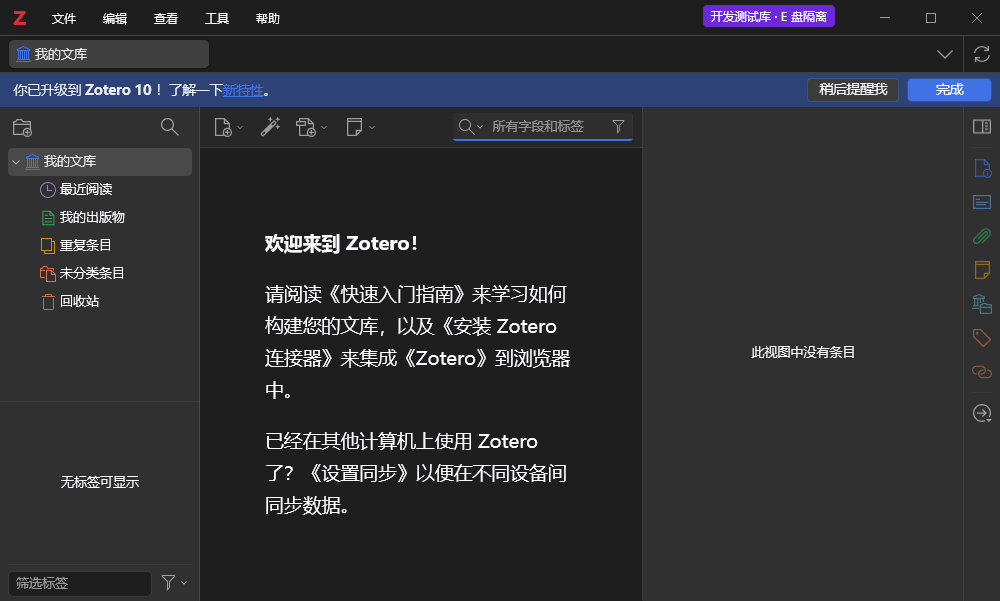

# P0 隔离环境验收

日期：2026-11-01。结论：P0 通过；产品插件功能 P1–P5 尚未验收。

## 实测环境

- Zotero 10.0.7，BuildID 20261029202124；Node v24.11.1；Chrome 156.0.8078.76。
- 同一 Zotero 程序，独立 E 盘 profile 与空数据库；未复制正式库或登录同步。
- 当前实际 DPI 192（200%），深色主题。窗口内容截图 1000×601 CSS 像素；另有 2026×1214 物理像素的原生窗口捕获保留在 runtime。
- 日常 Zotero 父进程在测试期间保持运行，未向其安装探针或产品插件。

## 判定结果

| 项目 | 实际结果 |
| --- | --- |
| 路径与门槛测试 | 8/8 通过、失败 0、跳过 0；包含实际 junction、父路径越界、大小写以及缺少视觉证据时拒绝完成 |
| 实际配置与库 | 探针与进程双重核验 E 盘 profile/data，文献数 0、账号为空 |
| 同步与集成 | 自动/个人/群组文件同步关闭，Connector 服务关闭；Word/LibreOffice 自动安装跳过 |
| 重启 | 跨多次重启生成不同 runId，旧报告被拒绝；统一启动入口实际验证通过 |
| 正式文件 | 6 个已登记文件 SHA-256 保持一致：程序、app 配置/归档、正式 prefs、profiles.ini 和 Word 模板 |
| 关闭 | 仅测试实例正常退出，回环开发端口关闭，日常实例仍在 |
| 快照 | 关闭状态备份 829 个文件并校验；恢复副本 773 个数据文件一致，数据库 quick_check=ok、文献数 0 |
| 初始视觉 | 已查看实际窗口；菜单、侧栏和空库布局可见，E 盘开发测试标识清晰，无遮挡 |

机器判定及截图指纹见 [P0.json](P0.json)，运行 `npm run milestone:check -- P0`。包含视觉证据才允许通过。

## 已定位的问题与修正

1. 受限执行环境禁止创建 junction，首次单元测试 3 过/1 失败；改为具备本机文件权限的测试运行后，真实 junction 拒绝测试通过，未跳过该测试。
2. Windows 启动器 PID 与实际 Zotero 父进程不同。改为按可执行文件、profile/data 参数唯一识别，并与探针内部 PID 对照，不会按旧启动器 PID 关闭其他程序。
3. 测试扩展最初未被加载。内置开发者接口返回 `applications.zotero.update_url not provided`，补齐清单后成功临时加载。当前统一启动入口每次显式加载探针，避免依赖未验证的扩展目录自动扫描。
4. PowerShell 对“该端口没有监听”的查询可能返回非零退出码，最初被当成启动失败。改为先可靠列举监听端口再筛选，不屏蔽真正的进程/网络查询错误。

## 边界与回退

这是空库开发环境验收，未测试三模式、原文批注、滚动联动或豆包任务 UI。后续 UI-01–08 必须逐项验证，不能引用本截图替代。

6 文件基线不等于对活跃正式库做全量备份或系统级写入审计。独立 profile/data 是正常开发数据隔离，不是权限沙箱。P0 恢复检查只针对空库副本；包含真实批注的完整恢复在 P5 验收。

Git 标签只回退源码，不自动撤销 Zotero 数据写入。测试数据使用关闭状态快照恢复；正式库当前未参与写入或恢复操作。敏感运行记录不提交 Git，公开的初始空库截图作为已审查视觉证据归档。
