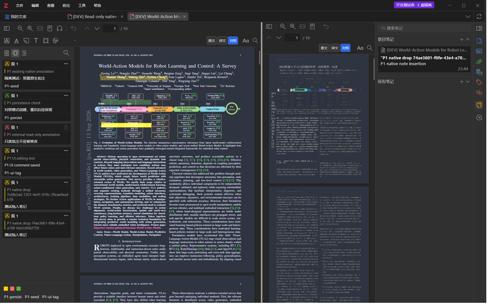
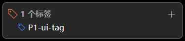

# P1 原生批注原型：进度检查点

记录时间：2026-11-02。**P1 尚未放行，不生成 milestone/p1。** 用户已接受正式 prefs.js 的历史变化，不再以此阻断开发；具体原因仍未证实。原始基线保留，恢复后的真实测试运行前后 6/6 受监测文件一致，见 [恢复运行复核](P1-resumed-isolation.json) 和 [用户决定](../ISOLATION_DECISIONS.md)。P1 剩余完整系统鼠标拖拽、剪贴板快捷键与跨栏焦点交互覆盖。

当前单元测试 **16/16**；下方 15/15、13 组/76 断言为首次检查点的历史统计。恢复运行另通过原生拖放处理/笔记回链 4 项回归；未以重复回归增加独立案例计数。

## 已实现与验证

开发包 0.1.0 采用插件方式，保留 Zotero 管理的原文 ReaderTab、browser、internalReader 和原父容器，在旁边增加只读译文窗格。原文批注继续保存到原附件，不覆盖 PDF。支持原文、译文和对照切换，以及可拖动/键盘调整的分隔条；尚无滚动联动。

测试环境：Windows，Zotero 10.0.7，Node 24.11.1，独立 E 盘 profile/data，公开 19 页原文和豆包导出副本。真实 UI 证据为深色、DPR 1.25，窗口 1280×800/1600×1000；截图分别为 1600×1000/2000×1250 像素。P0 初始 DPR 2 是此前另一组环境值，不能混用。

- 单元测试 **15/15**，失败/跳过均 0：路径与 junction、防错误配置加载、切换排队/取消/错误恢复、里程碑拒绝缺证据，以及保护文件报告。
- 选取 **13 组通过的真实集成案例、76 个通过断言**，清单与原始报告指纹见 [P1-evidence.json](P1-evidence.json)。此数字不包含被修正前的失败实验；失败经过见下文。
- 高亮、下划线、便签、文字、区域和绘图：原文单栏、对照各 6 类浏览器引擎指针创建通过；文字由原生输入框输入保存。原生管理器另验证 6 类保存/删除、评论/标签/改色/删除、已有批注坐标和归属。
- 评论编辑框及原生标签组件确实保存到测试数据库；只读外部批注、只读测试群组库保留权限，4 项检查通过。测试群组仅为离线本地夹具，无账号/同步。
- 原生添加到笔记、原生拖拽起始与接收处理、原文/批注回链、富文本/纯文本复制序列化通过。拖放事件由脚本在真实阅读器和原生笔记编辑器中触发，**不宣称操作系统鼠标完整拖动已覆盖，也未改写用户系统剪贴板来测试复制**。
- 关闭重开 5 项、真实进程重启后保留 5 项、禁用后保留/清理 10 项通过。关闭标签清理窗格、工具栏引用和观察器。
- 20 次顺序切换、快速请求最后状态生效、分隔条拖动、无重复 pane/排队泄漏，共 7 项通过。
- 注入仅针对一个测试批注键的保存失败后，原生错误条、保护性只读、数据库不产生假保存及等待完成均通过；注入函数在 finally 恢复。原生内部 Promise 的完成不能单独解释为保存成功。

## 视觉复核

原文单栏、对照布局、原生批注侧栏、颜色菜单、评论/标签、原生笔记、保存失败和禁用恢复共保留 8 张截图及 SHA-256。已实际查看，不以 DOM 存在代替视觉检查。UI-03 在 P1 仅记录布局和分隔条；页内同步对齐与几何误差须由 P2 单独验收。UI-04 整体保持未通过，系统鼠标拖拽、跨栏焦点的完整覆盖仍待完成；亮色主题/DPI 扩展也未验收。

原生标签浮窗是独立系统窗口，常规文档快照不包含它。捕获工具先核实所属测试进程，再单独捕获该窗口；没有截取日常 Zotero 或整个桌面。

## 此前隔离复核与后续决定

2026-11-01 23:56 最终校验发现 6 个保护文件中 **5 个与首次基线一致，1 个不一致**：正式 profile 的 prefs.js，文件最后修改时间 23:49:28.500911。用户明确回复当时没有操作日常 Zotero。

- 原始 SHA-256：`e507cf55f2ebe2988cd731fbf8ceefb503a1515b61d4deb64e591dc49271b6f2`
- 实测 SHA-256：`f9cd332027c70a4baef2a6f63f2a2aa7dd9039670e4c5ec0a0abc93933de6885`
- 只读扫描未发现开发配置标识、开发数据标识、插件配对偏好或本项目路径；这只能排除这些明显标记，不能证明修改来源。
- 初始基线只保存文件哈希，没有保存配置内容或逐键指纹，因此无法重建具体变化；没有将正式配置全文复制到项目。不能据此归因于测试插件，也不能据此认定只是日常程序自动保存。
- 已正常关闭测试父进程 13916；00:00 只读确认测试进程 0、调试端口 61357 监听 0，日常父进程 44468 仍运行。共享程序、app 配置、omni.ja、profiles.ini 和 Word 模板保持初始哈希。
- 原始基线未重置、正式配置未被本任务回写。当时停止真实实例测试并保留差异。用户后续决定已解除该历史变化的阻断；基线仍未重新采样。

修正审计报告原先只展示基线 sha256、没有展示实测哈希的问题。新报告明确区分 baselineSha256/observedSha256，新增单元测试证明发生改变或删除时不误报通过。P1–P5 增加 isolationAudit 门槛。最初启动器拒绝全部历史漂移；按用户后续决定改为仅接受登记的正式 prefs.js 跨运行历史变化，其他文件/文件丢失仍拒绝；本次运行前后比较严格保留。本阶段检查程序应拒绝完成。

## 失败实验与修正

1. 直接使用原生 PrintWindow 捕获后台主窗口，曾得到旧合成帧；改用实际 Gecko 窗口快照并在测试中刷新绘制，恢复正常刷新。曾观察到译文 canvas 暂缺；最终两种窗口与反复重建的可见页绘制通过。尚未对后台/最小化做长期稳定性验收，不能将测试刷新当产品修复或性能数据。
2. 初始原生管理器参数跨域读不到属性，改为 cloneInto 进入对应阅读器窗口；脚本模块缓存导致旧测试未更新，改为 ignoreCache。测试超时控制器使用主窗口的 AbortController。
3. 只读群组夹具最初遗漏 description，补齐后权限 4 项通过。文字工具最初拖到已有批注区域而没有产生输入，改为可见页空白位置单击并输入后，六工具操作通过。
4. 标签浮窗在后台处于 showing，文档快照不含系统弹窗；保留状态实测值，另按测试进程所属窗口捕获，实际显示标签内容，不把 showing 伪写为 open。
5. 原生保存回调完成语义曾被误当作必须抛出错误；以实际错误 UI、保护性只读与未入库验证失败处理，不改原生回调。
6. 快速模式请求与停用可能交错初始化，加入按标签排队、最新请求生效和取消标记；关闭原文标签后显式释放观察器与工具栏引用。
7. 窄栏页数文本使用原生绝对定位导致挤压，限定在对照布局内改为正常占位，窄栏将导航独立一行，最终两种窗口复查通过。
8. Windows 锁住已加载 XPI 导致覆盖构建失败，改为确定性压缩并按内容 SHA 命名文件；不覆盖正在运行的旧包。受限环境不能创建真实 junction 的首次回归为 11/12，使用允许该低风险测试的环境后通过；首次检查点 15/15，后续增加历史配置例外范围测试后 16/16。

## 开发包与复现

候选包：dist/doubao-translate-dev-57e05eff22750f9b.xpi，18,758 字节，5 个条目；SHA-256 `57e05eff22750f9b3f8a85d1608d6f1f09a4b793fc222716cb1011392b7a3575`。包只含 manifest、bootstrap、main、LICENSE、NOTICE，没有测试库或凭据。源码 AGPL-3.0-only，来源见根目录 NOTICE。

历史配置变化已解除阻断，测试仍须通过路径/进程与本次运行前后检查。可独立运行 `npm test`、`node tools/dev-env.mjs protected-audit`、`python tools/build-dev-xpi.py`、`npm run milestone:check -- P1`。最后一项预期拒绝完成。`tools/run-suite.mjs` 保留各具名案例和诊断，运行前必须有归属已核实的独立实例及临时开发插件；不能直接连接日常实例。

豆包 worker、自动下载归档、滚动联动尚未实现。候选包不是可安装到正式库的发布版本。

## 后续复制事件探查（未通过）

尝试以 ClipboardEvent 检查完整复制/粘贴时，事件返回的数据对象与传入构造参数的对象不同；能列出格式，但读取返回空字符串。该探查没有判为通过，未把缺失的交互验收自动勾选，也未因此更改产品代码；临时探查不进入稳定验收案例，失败报告留在本机 artifacts。此次探查未调用系统剪贴板写入或复制命令。原有原生序列化与拖放处理检查继续有效，系统快捷键与真实鼠标流程仍需单独覆盖。
