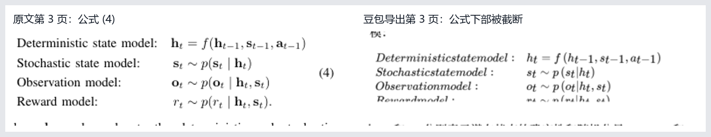

# 豆包 PDF 翻译脚本探查记录

日期：2026-11-01（北京时间）

## 当前结论

已通过实际操作验证完整链路：独立 Chrome 中手动登录豆包后，脚本上传并发送公开 PDF、打开附件预览、开启中文翻译、选择“下载翻译版”，最后等待下载事件并保存文件。

本次下载成功，但发现两个影响 Zotero 使用的限制：译文为图片型 PDF，没有文字层；第 3 页的部分公式存在截断。因此，可以继续开发阅读与归档原型，但不能把该译文视为原文的高保真替代件。

## 已验证的事实

| 项目 | 证据与结果 |
|---|---|
| 首页访问 | `https://www.doubao.com/chat/` 返回 HTTP 200。 |
| 浏览器脚本控制 | Playwright 已打开独立 Chrome，读取页面并成功关闭推广弹窗、打开登录入口。 |
| 原文样本 | arXiv 2609.16074；标题为 World-Action Models for Robot Learning and Control: A Survey。PDF 工具确认 19 页、4,531,144 字节。 |
| 下载入口 | PDF 组件包含原文下载和译文下载两个处理分支；译文菜单文字为“下载翻译版”。 |
| 页数检查 | 当前下载菜单仅在页数不超过 50 页时进入译文导出处理。该检查不能推广为整个产品的统一限制或账号权益说明。 |
| 导出机制 | 译文导出组件逐页获取译文覆盖层，渲染为画布，转为 PNG，并嵌入新建 PDF 页面，随后触发浏览器下载。 |

## 实际下载文件检查

| 指标 | 原文 | 豆包译文 |
|---|---:|---:|
| 文件大小 | 4,531,144 字节 | 16,091,295 字节 |
| 页数 | 19 | 19 |
| 页面尺寸 | 全部为 612 × 792 pt | 与原文逐页一致 |
| 可提取文字字符数 | 119,857 | 0 |
| 字体引用数（逐页合计） | 147 | 0 |
| 图片引用数（逐页合计） | 77 | 19 |

译文全部 19 页均能渲染。浏览了全篇缩略图，并对第 1、3、10 页做了放大检查：正文已显示中文，图表整体位置大体保留；第 3 页公式 (4) 下方的 Reward model 一行、公式 (5) 下部等区域出现截断。以上是版面抽查，不代表已经逐句核验翻译准确性。

交付文件：

- `world-action-models.zh-CN.doubao.pdf`：实际从豆包下载的译文，未另行重排或添加 OCR。
- `doubao-pdf-validation.json`：逐页尺寸、文字、字体及图片检查结果。
- `doubao-formula-comparison.png`：第 3 页公式截断的对照证据。

此次导出约需 3–4 分钟。页面进度提示从逐页翻译转为导出、下载，最后由浏览器产生文件下载事件。

## 对 Zotero 插件设计的影响

1. 浏览器自动化具有可验证的技术路径。第一版可以围绕实际页面操作构建，不必先假设存在可公开调用的文档翻译 API。
2. 下载流程涉及浏览器侧生成文件，应等待真正的下载事件，并验证文件完成写入；不能仅凭网页第一页出现中文判定整篇翻译完成。
3. 实际译文已确认没有文字层。在 Zotero 中可显示、进行区域批注；要支持基于文字层的划词、文字高亮与全文检索，需要另加 OCR。OCR 不能修复已经被截断的公式。
4. 此样本的原译文页数和页面尺寸完全对应，适合先做同页号联动。不能因此认定其他论文也都保持页面一一对应，更不能认定相同滚动位置总是同一段内容。
5. 第一版应保留原文为主要附件、将译文另存为子附件；切换模式时使用明确的附件关联，而不是仅按文件名查找。译文版面问题应允许用户随时对照原文核验。
6. 导出涉及分钟级处理，应提供进度、取消、失败提示和可恢复任务；不能使用很短的固定等待时间代替下载完成检测。

## 本次执行步骤

1. 用户在独立测试 Chrome 中手动完成登录。
2. 点击上传控件，选择公开论文 PDF，等待解析完成。
3. 发送附件及简短指令，等待对话建立，再点击已发送的 PDF 卡片。
4. 在 PDF 预览的提示中点击“开始翻译”。
5. 悬停下载图标，菜单实际显示“下载原文件”和“下载翻译版”。
6. 选择“下载翻译版”，等待浏览器下载事件，并保存完整文件。
7. 检查 PDF 文件结构与全部页面的渲染结果。

实际操作中还确认：发送消息后页面会从临时对话地址切换到正式地址，原来的页面元素引用随之失效。自动化应重新定位已发送的附件卡片。

## 验证边界与后续工作

- 本次是一个账号、一篇 19 页论文的一次成功验证，尚未测试重复运行、重新登录、网页更新或更多文档。
- 尚未验证其他翻译引擎或设置能否改善公式截断，也未测试超过 50 页的文档。
- 尚未实现 Zotero 插件、自动归档和双栏联动。
- 尚未验证失败恢复、账号额度、批量处理和跨设备行为。

## 公开代码依据

- [PDF 阅读与下载菜单组件](https://lf-flow-web-cdn.doubao.com/obj/flow-doubao/doubao/chat/static/js/async/s2-standalone-pdf-canvas-definition.3a54a25c50.js)：包含原文与译文下载分支、菜单文案及 50 页条件。
- [译文导出组件所在代码包](https://lf-flow-web-cdn.doubao.com/obj/flow-doubao/doubao/chat/static/js/async/p0.a5792da926.js)：模块 `wVX` 中的导出处理包含逐页翻译覆盖层、画布转图片、写入 PDF 和保存文件。
- [公开原文样本](https://arxiv.org/abs/2609.16074)。

这些资源为本次访问时的公开版本；网页更新后文件名、控件及实现可能变化。代码分析与实际下载验证分别记录，不能互相替代。

